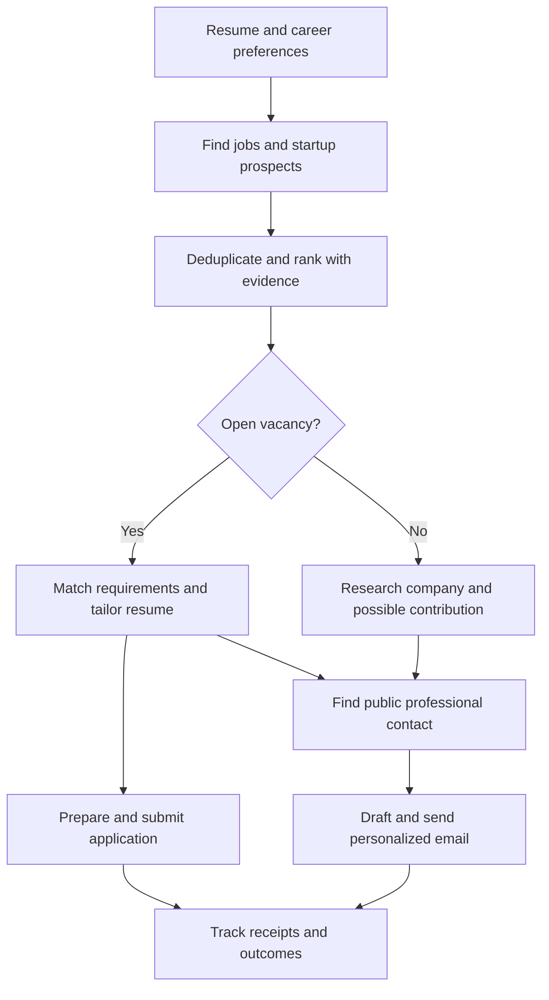

# Backend build guide

Build a job-search assistant that discovers relevant vacancies, prepares truthful tailored resumes, helps submit applications, and finds appropriate business contacts for startup outreach—even when no vacancy is advertised.

This documentation was prepared from the repository on 2026-10-18. Steps 01–05 and 07–08 are implemented with the verification noted in [implementation progress](implementation-progress.md). Step 09 has an opt-in Gmail adapter with offline fixtures; live OAuth and mailbox behavior are unverified. Step 06 and release-grade portions of step 10 remain incomplete. See the [operations runbook](operations.md); this repository is not production-ready.

## Start here

1. [Codebase map](codebase-map.md): what exists, where it lives, and what needs attention.
2. [Backend specification](specification.md): product behavior, architecture, data, APIs, automation, and acceptance criteria.
3. [Master prompt and 10 build prompts](build-prompts.md): copy the master prompt into your coding session, then run prompts 01–10 in order.

The specification and prompts describe **proposed work** unless explicitly marked existing. They supersede older milestone descriptions for this backend expansion. Existing endpoint behavior remains the compatibility baseline until deliberately migrated.

## What the finished product does

“High ATS score” means improving this application's explainable compatibility estimate without inventing experience. “Less crowded jobs” means observed applicant counts when available, plus clearly labeled visibility signals when counts are unavailable. Neither score guarantees an interview.

The current code supports discovery, ranking, tailored documents, application packages, and editable outreach drafts. A Gmail adapter is opt-in and approval-gated, with accepted/unknown send tracking and manual reply polling. User-authorized actions are checked by the durable worker. Contact research and production release operations still need work.

## Two ways the product finds work

**Path A — a job is listed.** The backend reads career pages and job feeds, saves the posting with its source, and scores how well the user's real experience matches it. It then prepares a tailored resume and, where a supported integration exists, submits the application. If the site cannot be submitted automatically, the user gets a complete package and applies by hand. The tracker shows `applied` only after a confirmed receipt.

**Path B — no suitable opening is listed.** The backend still looks for startups that fit the user, especially ones that look less crowded. "Less crowded" means a recent applicant count when the source actually publishes one. When the count is missing, the app says unknown. It may still flag a company as potentially overlooked (new posting, company site only, narrow specialty), and it labels that as a guess. It then looks for a public founder, hiring, or team contact and drafts a short cold email. A guessed email address is never shown as a verified one.

Both paths use the same rules: do not invent jobs, skills, metrics, founder names, or send success. Unknown stays unknown.

## The 10 build steps

Paste the master prompt from [build-prompts.md](build-prompts.md) once. Then run these in order. Each prompt says exactly when it is done.

| Step | What you build | Finished when |
|---|---|---|
| 01 | Lock down who owns each record, and make every web fetch safe | Another user cannot read your resume or job. A redirect cannot reach a private address. |
| 02 | A worker that remembers tasks, approvals, and retries | A crash after save does not lose or double-run the work. |
| 03 | Scheduled job discovery from real sources | The same job from two sites becomes one listing. A failed fetch does not mark jobs closed. |
| 04 | Ranking, plus startups with no opening | Fit, eligibility, and applicant-count evidence stay separate. Saving twice does not create two applications. |
| 05 | Truthful tailored resumes and a readable PDF | The resume only says things the user can prove. Missing skills stay listed as gaps. |
| 06 | Find a founder or hiring contact | A startup with no job can still produce a sourced contact. Guessed emails stay unverified. |
| 07 | Prepare and submit an application | A retry does not submit twice. Unanswered required questions block sending. |
| 08 | Write the cold email | Vacancy emails and no-opening introductions are editable drafts. Creating a draft never sends it. |
| 09 | Send the email and track replies | A reply, bounce, or opt-out stops follow-ups. A provider accepting the message is not the same as the person reading it. |
| 10 | Run both paths end to end and write the operations guide | A local walkthrough works, and the report says what was really tested. |

The table above is the target build sequence. Current implementation status and
unverified dependencies are tracked in [implementation progress](implementation-progress.md).

Do not start step 03 until steps 01 and 02 exist. Later steps depend on the task runner, the safe fetcher, and the saved resume evidence.
